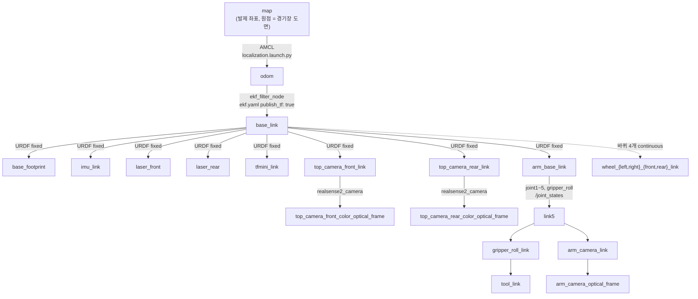
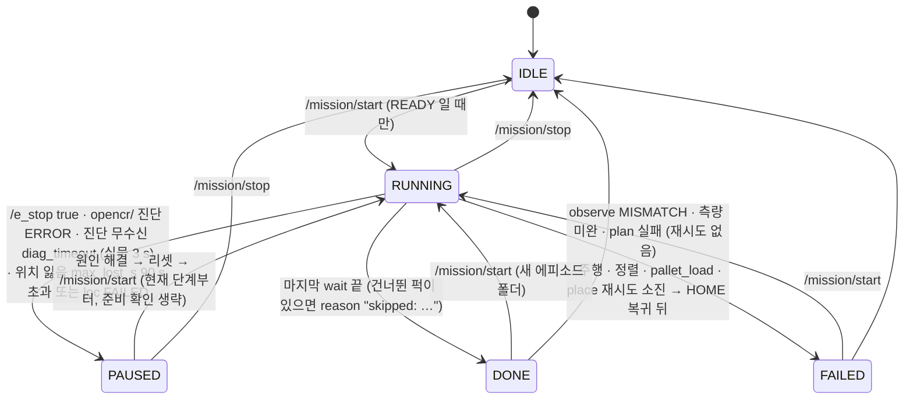
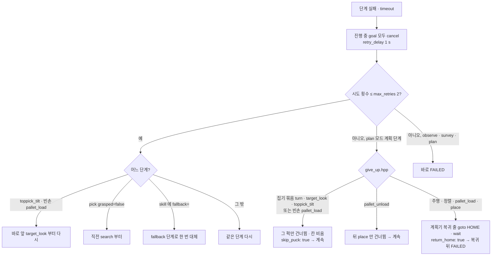
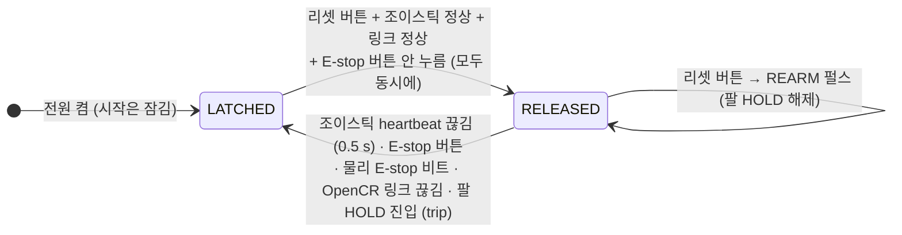
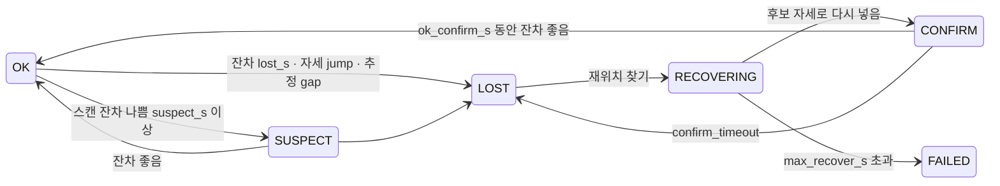

# 시스템 구조 (최종 제출)

기준: `dev` 2026-11-17 (`0bbc537`, PR #320 병합 뒤). 중간 제출 [`submission/midterm/nodes_topics_states.md`](../../submission/midterm/nodes_topics_states.md) (Integration 2026-11-09) 를 지금 코드에 맞춰 고쳐 쓴 것이다.
이 문서의 모든 내용은 아래 "근거" 에 적은 파일에서 가져왔다. 표 전체 (타입 · QoS · 발행 · 구독) 의 원본은 [`workspace/docs/interfaces.md`](../../workspace/docs/interfaces.md), 이름 상수는 [`robot_interfaces/include/robot_interfaces/names.hpp`](../../workspace/ros2_ws/src/robot_interfaces/include/robot_interfaces/names.hpp) 이다.

> **실제 경기 구성 (2026-11-16) 주의** — 경기 당일 전체 미션 (`ros2 launch bringup bringup.launch.py` → `/mission/start`) 은 첫 단계 observe 에서 두 번 모두 FAILED 였다
> (`project2/results/real_20261116/mission_log/261116_1236*/mission_log.jsonl`: `observe failed after 2 retries: manipulator: /manipulator/execute_skill goal rejected`).
> 같은 시각 launch 로그 (`launch_logs/demo_261116_123545.log` 1050 행) 의 원인 문구는 `execute_skill: startup to 'DRIVE' not finished (REARM, wait for 'startup: arm at DRIVE') -> reject` —
> 그 앞 548 · 798 · 989 행에 `startup: arm is not at STOW (0.23 rad) nor 'DRIVE' (3.61 rad) -> not moving` 이 있다 — 팔이 STOW 에서 0.23 rad 어긋나 켜질 때 팔 정리 (STOW → DRIVE, `control/include/control/startup_stow.hpp`) 가 **시작 자체를 거부**했고, DRIVE 에 못 간 채로 미션을 시작해 manipulator 가 goal 을 거절했다. 그날 STOW 값이 #311 → #314 → #316 으로 여러 번 바뀐 것이 배경이다.
> 그 뒤 경기는 **팔 없이 Nav2 주행만 하는 시연 도구** [`workspace/tools/drive_demo`](../../workspace/tools/drive_demo/README.md) (`run_demo.sh real`, 미리 계산한 10 구간) 로 진행했다.
> 기록: `project2/results/real_20261116/drive_runs/` (가장 많이 간 판 `1116_1225_…` = 10 구간 중 4 구간 성공). 즉 아래 1 ~ 4 장은 **설계 · 구현된 전체 구조**이고, 경기에서 실제로 돈 것은 5 장의 축소 구성이다.

---

## 1. 노드 구성

근거: `bringup/launch/bringup.launch.py` (머리말 ① ~ ⑧), `opencr_hardware/launch/base_bringup.launch.py`, `perception/launch/perception.launch.py`, `localization/launch/localization.launch.py`, `navigation/launch/navigation.launch.py`, `mission_planner/launch/planner.launch.py`.

| 프로세스 · 컨테이너 | 노드 | 패키지 | 하는 일 |
|---|---|---|---|
| ① ros2_control_node | `OpenCRHardware` (SystemInterface), `diff_drive_controller`, `arm_controller`, `gripper_controller`, `joint_state_broadcaster`, `imu_sensor_broadcaster` | opencr_hardware | OpenCR 2 대 (주행 ID 1~4 · 팔 ID 11~16) USB, 잠금식 E-stop (`estop_latch.hpp`), `/diagnostics` · `/battery/*`, 펌웨어 버전 확인 |
| ② base_container | `robot_state_publisher`, `twist_mux`, `joy_node` (또는 `rc100_joy`), `teleop_twist_joy`, `joy_teleop` | opencr_hardware | URDF TF, 속도 명령 우선순위 · 잠금, 조이스틱 → 속도 · 시작/정지 서비스 |
| 센서 드라이버 (`sensors.launch.py`) | `coin_d4_driver` ×2, `realsense2_camera` ×2, `arm_camera_node` | bringup, perception | LiDAR (LDS-03) 앞 · 뒤, D435 앞 · 뒤, 팔 Arducam |
| ⑦ perception_container | `perception_node`, `scan_merger`, `rear_obstacle` | perception | 신호등 · 바코드 · 퍽 · 장소 태그 · 주사위 칸 · 장소 상자 인식, `/arm_range`, 스캔 합치기, 뒤 장애물 |
| ⑦ 옆 단독 | `puck_survey` | perception_survey | 시작 박스 6 개 · 퍽 12 칸 측량 → 퍽 등록표 |
| ⑧ control_container (`component_container_mt`) | `mission_node`, `drive_node`, `manipulator_node`, `tfmini_node`, `obstacle_stop` | mission, control, perception | 미션 순서 · 바퀴 정렬/skill · 팔 IK/집기/놓기 · TFmini 박스 거리 · 비상 정지. 카메라 인식을 꺼도 안전 정지가 남게 TFmini 와 같은 프로세스 (`split_control:=true` 면 넷으로 나눔, #265) |
| ⑥ | `odom_icr`, `ekf_filter_node` | bringup, robot_localization | 바퀴 vx + 회전 중심 옆 이동 vy (#92) + IMU yaw rate → `/odometry/filtered`, `odom → base_link` |
| 위치 추정 (`use_localization`) | `map_server` (`/map`), `map_objects_server` (`/map_objects`), `scan_body_mask`, `scan_merge`, `amcl`, `loc_monitor`, lifecycle 관리자 | localization, perception (C++ 판 `loc_scan_merge` · `loc_monitor`, #310) | 발제 좌표 지도 위 AMCL, 위치 잃음 판정 · 잠금. `localization:=carto` 면 cartographer 계열 |
| 주행 (`use_nav2`) | Nav2 (`nav2_composed`: planner · controller · smoother · behavior · bt_navigator · collision_monitor …) | navigation | Smac 2D · RotationShim + MPPI, 마지막 출력만 `/cmd_vel_nav` |
| 단독 (`use_planner`) | `mission_planner_node` | mission_planner | 신호 · 바코드 · 퍽 등록표 → 할당 · 적재 · 경로 계획 (`/mission_planner/plan`) |

명령 주체는 하나다: 바퀴 = `drive_node` (Nav2 도 drive 를 거쳐 호출), 팔 · 그리퍼 = `manipulator_node`. `mission_node` 는 순서만 정하고 `/cmd_vel` · 관절 명령을 내지 않는다 (`mission/src/mission_node.cpp` 머리말, `interfaces.md` 공통 규칙).

---

## 2. 노드 · 토픽 · 서비스 · 액션

### 2-1. 그래프 (미션 경로)

```mermaid
flowchart LR
  subgraph 센서
    LDS[LiDAR 앞 · 뒤<br/>coin_d4_driver]
    D435[D435 앞 · 뒤<br/>realsense2_camera]
    ARD[팔 Arducam<br/>arm_camera_node]
    TFM[tfmini_node]
  end
  subgraph 인식
    SM[scan_merger]
    PER[perception_node]
    SUR[puck_survey]
    OBS[obstacle_stop]
    REAR[rear_obstacle]
  end
  subgraph 위치
    AMCL[amcl + map_server]
    LOC[loc_monitor]
    EKF[odom_icr → ekf]
  end
  subgraph 판단 · 제어
    MIS[mission_node]
    PLN[mission_planner_node]
    DRV[drive_node]
    MAN[manipulator_node]
    NAV[Nav2]
    MUX[twist_mux]
  end
  HW[OpenCRHardware<br/>ros2_control]

  LDS -->|/scan_front · /scan_rear| SM -->|/scan| NAV & DRV
  LDS --> AMCL
  D435 -->|color · aligned_depth · camera_info| PER & REAR
  ARD -->|/arm_camera/image_raw| PER
  TFM -->|/tfmini/range| OBS & DRV
  PER -->|/perception/signal · /perception/barcode| MIS & PLN
  PER -->|/perception/pucks| SUR & MAN & MIS
  PER -->|/perception/result| MIS & DRV & MAN
  PER -->|/arm_range| MAN
  PER -->|/perception/place_box · status| MIS
  REAR -->|/perception/rear_obstacle| DRV
  SUR -->|/perception/puck_survey · 완료 파일| MIS
  AMCL -->|TF map→odom| LOC -->|/localization/status| MIS & DRV & SUR
  LOC -->|/localization/lock| MUX
  OBS -->|/perception/obstacle_stop| MUX
  HW -->|/odom · /imu/data| EKF -->|/odometry/filtered| NAV & DRV
  HW -->|/e_stop · /diagnostics| MIS & MUX & MAN
  MIS -->|srv /mission_planner/plan| PLN
  MIS -->|act /drive/navigate · align · execute_skill| DRV
  MIS -->|act /manipulator/pose · pick · execute_skill| MAN
  MIS -->|srv /perception/set_mode · check_dice · survey/*| PER & SUR
  MIS -->|/perception/snapshot| PER
  DRV -->|act navigate_to_pose · spin| NAV -->|/cmd_vel_nav| MUX
  DRV -->|/cmd_vel_drive| MUX -->|/cmd_vel| HW
  MAN -->|act follow_joint_trajectory · gripper_cmd<br/>/arm_controller/joint_trajectory| HW
```

### 2-2. 주요 토픽

근거: `workspace/docs/interfaces.md` "토픽", `names.hpp`. QoS 이름은 `names.hpp` `qos::` 와 같다.

| 토픽 | 타입 | 발행 | 구독 |
|---|---|---|---|
| `/scan_front` · `/scan_rear` → `/scan` | sensor_msgs/LaserScan | coin_d4_driver → scan_merger | Nav2, drive_node (localization 쪽은 `scan_body_mask` · `scan_merge` 를 따로 거침) |
| `/top_camera_{front,rear}/color/image_raw` · `/aligned_depth_to_color/image_raw` · `camera_info` | Image · CameraInfo | realsense2_camera | perception_node, rear_obstacle |
| `/arm_camera/image_raw` · `camera_info` | Image · CameraInfo (실물 1280×720) | arm_camera_node | perception_node |
| `/tfmini/range` | sensor_msgs/Range, 50 Hz | tfmini_node | drive_node (FINE 정렬), obstacle_stop |
| `/perception/result` | robot_interfaces/PerceptionResult | perception_node | mission, drive, manipulator |
| `/perception/pucks` | robot_interfaces/PuckArray | perception_node | puck_survey, manipulator (target_look), mission (verify ID 기록) |
| `/perception/signal` · `/perception/barcode` | SignalSequence · Barcode | perception_node | mission (plan 모드), mission_planner |
| `/perception/task_marker` | TaskMarker | perception_node (READ_MARKER) | mission (verify 장소 태그 기록) |
| `/perception/puck_survey` | std_msgs/String (JSON), latched | puck_survey | 모니터링 (mission 은 `survey/finish` 응답의 파일 경로를 씀) |
| `/perception/place_box` · `/cells` · `/status` | PoseStamped · PoseArray · String | perception_node | mission (measure_box, #73) |
| `/arm_range` | sensor_msgs/Range | perception_node (팔 끝 `tool_link` → 퍽 **표면**) | manipulator |
| `/perception/obstacle_stop` (+ `/reason`) | std_msgs/Bool, latched 10 Hz | obstacle_stop | twist_mux lock (priority 60) |
| `/perception/rear_obstacle` | std_msgs/Bool | rear_obstacle | drive_node (후진 확인, #84) |
| `/localization/status` | std_msgs/String (OK · SUSPECT · LOST · RECOVERING · CONFIRM · FAILED) | loc_monitor | mission, drive (`loc_gate`), puck_survey |
| `/localization/lock` | std_msgs/Bool | loc_monitor | twist_mux lock (priority 20, Nav2 만 막음, #93) |
| `/odom` → `/odom_icr` → `/odometry/filtered` | nav_msgs/Odometry | diff_drive_controller → odom_icr → ekf | Nav2, drive |
| `/cmd_vel_teleop` · `/cmd_vel_drive` · `/cmd_vel_nav` → `/cmd_vel` | TwistStamped | teleop · drive_node · Nav2 → twist_mux | diff_drive_controller |
| `/arm_controller/joint_trajectory` | JointTrajectory | manipulator (정책 · 처짐 보정 스트리밍) | arm_controller |
| `/e_stop` | std_msgs/Bool, latched 10 Hz | OpenCRHardware | twist_mux lock (255), mission, manipulator |
| `/diagnostics` | DiagnosticArray (`opencr/link · motors · battery · estop`) | OpenCRHardware | mission (`opencr/` 만), manipulator (팔 HOLD) |
| `/mission/status` | robot_interfaces/MissionStatus (2 Hz + 변경 시) | mission_node | 모니터링 |
| `/mission/ready` | std_msgs/String, latched (`READY` · `NOT_READY: …`) | mission_node | 운용자 (`mission/src/mission_node.cpp` 327 행) |
| `/perception/snapshot` | std_msgs/String (파일 접두어) | mission_node | perception (이동 전후 사진) |

### 2-3. 서비스 · 액션

근거: `interfaces.md` "Action · Service", `robot_interfaces/{action,srv}`.

| 이름 | 종류 · 타입 | Client → Server | 용도 |
|---|---|---|---|
| `/mission/start` · `/mission/stop` | srv std_srvs/Trigger | joy_teleop (START 9 · BACK 8, `teleop.yaml`) · CLI → mission | 시작 (준비 표가 모두 OK 일 때만) · PAUSED 재개 · 정지 |
| `/mission_planner/plan` | srv std_srvs/Trigger | mission → mission_planner | 응답 `message` = 계획 단계 문장 (줄바꿈) |
| `/perception/set_mode` | srv robot_interfaces/SetPerceptionMode (비트: SEARCH_FRONT 1 · ARM_ALIGN 2 · READ_TAG 4 · SEARCH_REAR 8 · READ_MARKER 16 · READ_SIGNAL 32 · READ_BARCODE 64) | mission → perception | 인식 모드 |
| `/perception/check_dice` | srv robot_interfaces/CheckDice | mission → perception | 장소 3×3 칸 판정 (verify) |
| `/perception/survey/start · finish · revisit · reset` | srv std_srvs/Trigger | mission (CLI: reset) → puck_survey | 퍽 측량 |
| `/perception/place_box/measure` (`measure_front`) | srv std_srvs/Trigger | mission → perception | 장소 · 시작 상자 재기 |
| `/drive/navigate` | act nav2_msgs/NavigateToPose | mission → drive (→ Nav2 `navigate_to_pose`, 같은 위치면 `spin`) | goto · navigate |
| `/drive/align` | act robot_interfaces/AlignBase (`box_only`, #160) | mission → drive | COARSE · FINE 정렬, 빈 상자 접근 |
| `/drive/execute_skill` | act robot_interfaces/ExecuteSkill | mission → drive | `turn_p<deg>` · `turn_m<deg>` · `turn_0` (#77), 정책 |
| `/manipulator/pose` · `/manipulator/pick` · `/manipulator/execute_skill` | act ArmPose · Pick (`grasped`) · ExecuteSkill | mission → manipulator | 이름 자세, 집기, skill (`barcode_look` · `target_look` · `toppick_tilt` · `pallet_load/unload_*_tilt` · `place_*_tilt` · `box_look`) |
| `/arm_controller/follow_joint_trajectory` · `/gripper_controller/gripper_cmd` | act control_msgs | manipulator → ros2_control | 팔 · 그리퍼 |
| `/obstacle_stop` 파라미터 `approach_stop_m` | parameter | drive → obstacle_stop | FINE · 박스 접근 동안 정지 거리를 "목표 − 여유" 로 낮춤 (끝나면 0, 60 s 뒤 자동 복귀) |

공통 계약 (`interfaces.md`): 인식 · 거리 값은 `header.stamp` 기준 300 ms 넘으면 쓰지 않는다 (`names.hpp` `MAX_VALUE_AGE_S = 0.3`). 펌웨어 명령 무수신 정지는 200 ms 로 다른 규칙이다.

---

## 3. 좌표계 (TF)

근거: URDF [`opencr_hardware/urdf/robot.urdf.xacro`](../../workspace/ros2_ws/src/opencr_hardware/urdf/robot.urdf.xacro), [`workspace/docs/frames_tf.md`](../../workspace/docs/frames_tf.md), `bringup/config/ekf.yaml`, `localization/config/amcl.yaml`, `localization/launch/localization.launch.py`.

### 3-1. TF 나무



### 3-2. 프레임 · 발행 주체

| 변환 | 발행 | 값 · 비고 |
|---|---|---|
| `map → odom` | `amcl` (`amcl.yaml` `tf_broadcast: true`, `global_frame_id: map`). `localization:=carto` 면 `map_odom_relay` + 정적 `map → carto_map` | 초기 자세 = `start_x 0.69365 · start_y 0.950 · start_yaw π` (`localization.launch.py`). `frames_tf.md` 의 "slam_toolbox" 표기는 예전 판 — 지금 경기 구성은 AMCL |
| `odom → base_link` | `ekf_filter_node` 만 (`ekf.yaml` `world_frame: odom`, diff_drive `enable_odom_tf: false`) | 입력 `/odom_icr` (vx · vy) + `/imu/data` (yaw rate) |
| `base_link → base_footprint` | robot_state_publisher (URDF) | base_link 원점 = 바닥 위 6.75 mm. +X 앞 · +Y 왼 · +Z 위 (REP 103) |
| `imu_link` | URDF | (0.0095, 0, 0.0202), 실물 yaw −π/2 (보드 +y 가 차체 앞, 2026-11-09), Isaac 0 |
| `laser_front` · `laser_rear` | URDF | (±0.1318, 0, 0.0675), roll π (뒤집어 장착), 실물 yaw 앞 π · 뒤 0 (2026-11-15 실물 시험, PR #304) |
| `top_camera_front_link` · `top_camera_rear_link` | URDF | 앞 (−0.0481, +0.0250, 0.4836) pitch 0.5692 · 뒤 (−0.2079, −0.0250, 0.4836) pitch 0.5926 yaw π (2026-11-12 · 13 실측). 원점 = 왼쪽 IR (깊이 원점) |
| `top_camera_*_link → *_color_optical_frame` | **realsense2_camera** (실물, 공장 외부보정) · Isaac 브리지 `/tf_static` (모의) | URDF 는 만들지 않음 (부모가 둘이 되지 않게) |
| `arm_base_link` → `link1` … `gripper_roll_link` | URDF + `/joint_states` | arm_base_link (0.096, 0, 0.1135). joint1 요 · joint2~4 피치 · joint5 손목 롤 · gripper_roll (실물 = 그리퍼 개폐) |
| `arm_camera_link` → `arm_camera_optical_frame` | URDF | 부모 `link5` (0.088256, 0, 0.077446), pitch 15°. 광학 rpy (−π/2, 0, −π/2) |
| `tool_link` | URDF | `gripper_roll_link` + x 0.086. `/arm_range` 기준 |
| `tfmini_link` | URDF | (0.130, 0, 0.0243) = 바닥 위 31 mm, 렌즈면 원점 ★ 실측 전 설계값 |

정적 변환은 모두 URDF → robot_state_publisher 가 낸다. `static_transform_publisher` 는 `localization:=carto` 일 때의 `carto_map_tf` 하나뿐이다 (`localization.launch.py` 106 행). 광학 프레임 축: +X 영상 오른쪽 · +Y 영상 아래 · +Z 보는 방향.
점검: `ros2 run tf2_tools view_frames`, `ros2 run tf2_ros tf2_echo base_link top_camera_front_color_optical_frame` (`frames_tf.md` "점검").

---

## 4. 미션 순서: 관측 → 계획 → 주행 → 조작 → 재검증 → 복귀

근거: `mission/src/mission_node.cpp` 머리말 (단계 문법), `mission/config/mission.yaml` · `mission_plan.yaml`, `mission/include/mission/{readiness,give_up,return_check,verify_record}.hpp`, `mission_planner/README.md`, `workspace/docs/mission_stage_test.md`.

### 4-1. 단계 흐름 (plan 모드, bringup 기본 `mission_source:=plan`)

```mermaid
stateDiagram-v2
  direction LR
  state "준비 확인<br/>1 안전 · 2 컨트롤러 · 3 노드 서버 · 4 위치 · 5 Nav2" as READY
  state "① 관측 observe<br/>barcode_look + READ_SIGNAL|READ_BARCODE" as OBS
  state "측량 survey<br/>박스 6 곳 survey_view → finish (revisit)" as SUR
  state "② 계획 plan<br/>/mission_planner/plan" as PLAN
  state "③ 주행 goto / approach<br/>/drive/navigate → /drive/align" as DRV
  state "④ 조작<br/>target_look → toppick_tilt → pallet_load<br/>measure_box → pallet_unload → place" as MAN
  state "⑤ 재검증 verify<br/>box_look + check_dice + 태그 · 퍽 ID" as VER
  state "⑥ 복귀 goto HOME → wait 3" as RET
  [*] --> READY
  READY --> OBS: /mission/start (READY 일 때만)
  OBS --> SUR: 신호 CONFIRMED + 바코드 READ
  SUR --> PLAN: 12 칸 확정
  PLAN --> DRV
  DRV --> MAN
  MAN --> DRV: 다음 박스 · 다음 장소
  MAN --> VER: 장소마다 놓기 끝
  VER --> DRV: 다음 장소
  VER --> RET: 세 장소 끝
  RET --> [*]: DONE
```



`use_survey:=false pucks_file:=<등록표>` 면 측량을 건너뛰고 미리 만든 등록표로 계획한다. `planner_stop_after:=observe|first_pick|first_place` 로 앞 단계만 하고 복귀하는 부분 시험이 된다 (`bringup.launch.py`, `mission_stage_test.md`).

### 4-2. 단계별 완료 조건

| 단계 | 미션 단계 문장 | 완료 조건 (성공) | 실패 · 시간 제한 | 근거 |
|---|---|---|---|---|
| 준비 | — | `/mission/ready` = `READY` (1 E-stop 풀림 · 진단 정상, 2 `joint_state_broadcaster` · `diff_drive_controller` · `arm_controller` (+imu) active, 3 drive · manipulator · perception · 계획기 서버, 4 `/localization/status` OK, 5 `lifecycle_manager_navigation` active) | 하나라도 아니면 `/mission/start` 거절 (`not ready: …`) | `readiness.hpp`, README 운용 순서 4 |
| ① 관측 | `observe` | 팔 `barcode_look` skill 성공 + `/perception/signal` **CONFIRMED** (같은 12 개 순서 2 번) + `/perception/barcode` `read_ok` | `observe.max_cycles` 4 묶음 안에 못 맞추면 MISMATCH → 재시도 없이 FAILED. timeout 180 s | `mission_plan.yaml` observe, `mission_node.cpp` 1795 행 |
| 측량 | `survey_start` · `survey_view` · `survey_finish` | `/perception/survey/finish` 성공 = 12 칸 확정 → `pucks_survey.yaml` 기록 | 실패면 `revisit` 칸만 `TAG_VIEW` · 0.20 m 로 다시 (`max_rounds` 2). 미확인만 남으면 `on_unconfirmed: fail` → FAILED | `mission_plan.yaml` survey |
| ② 계획 | `plan` | 계획기 응답 `success` + 단계 문장이 비어 있지 않음 → 뒤에 붙여 실행. 기록 `signal.json` · `allocation.json` · `plan.json` · `mission_lines.txt` | 풀 수 없음 · 미등록 바코드 → 재시도 없이 FAILED. timeout 60 s | `mission_node.cpp` 2644 · 2661 행 |
| ③ 주행 | `goto x y yaw` | `/drive/navigate` (Nav2 `navigate_to_pose`) 성공. 위치를 잃은 동안은 시간에 세지 않고 기다림 | timeout 120 s, `max_retries` 2 | `mission.yaml` timeout · localization |
| ③ 접근 | `approach <d>` · `approach_box <d>` | COARSE (`align.coarse_distance` 0.45 m, 앞 D435) → 팔 `ALIGN` → FINE: TFmini 렌즈 → 박스 앞면 = `<d>` (≥ 0.13 m). 빈 상자는 `box_only` 로 TFmini 거리만 | timeout 90 s (박스 40 s) | `mission.yaml` align, `interfaces.md` AlignBase |
| ④ 집기 | `skill drive turn_*` · `skill manipulator target_look:…` · `toppick_tilt` · `pallet_load_<열>_<칸>_tilt` | 각 skill 결과 `success`. 빈손이면 manipulator 가 `empty hand` 로 실패 | `toppick_tilt` 실패 → 바로 앞 `target_look` 부터 (#69). 재시도를 다 쓰면 그 퍽만 건너뜀 | `give_up.hpp`, `mission.yaml` on_fail |
| ④ 놓기 | `measure_box <L>` · `pallet_unload_*_tilt` · `place_<L>_<dx>_<dy>_tilt` | 상자 재기 `status ok` (못 재면 `required: false` → 지도 좌표로) + skill `success` | `pallet_unload` 실패 → 뒤 `place` 만 건너뜀. `place` 실패 → HOME 복귀 뒤 FAILED | `mission_plan.yaml` place_box, `give_up.hpp` |
| ⑤ 재검증 | `verify <L> cx cy z expect9 y_shape` | `/perception/check_dice` 응답을 `mission_log.jsonl` `verify` 에 기록 (칸 판정 · 새로 본 퍽 ID · 장소 태그, 사진 `images/NN_after_<L>_k.jpg`). 마지막 verify 뒤 `verify_ids` (ID 중복 · 누락) | **틀려도 계속** (`stop_on_fail: false`, 복귀 점수를 위해). timeout 40 s | `mission_plan.yaml` verify, `verify_record.hpp` |
| ⑥ 복귀 | `goto <HOME>` · `wait 3` | wait 끝 → DONE. 처음 · 끝 자세로 차체 네 모서리가 출발 구역 (0.734, 0.95, 0.6 m 사각) 안인지 `return` 줄에 기록 (판정만) | — | `return_check.hpp`, `mission_plan.yaml` return_check |

---

## 5. 안전 정지 · 오류 처리

### 5-1. 미션 상태 (`/mission/status`, `control/include/control/fsm.hpp` `make_mission_fsm`)



- PAUSED 진입 (`mission_node.cpp` `pause()`): 진행 중 goal 을 모두 cancel, 재시도 대기 중이었으면 그 단계로 되돌림. **자동 재개 없음**.
- 시작 거절: E-stop · 진단 오류가 있으면 `cannot start: … — reset E-stop / fix the error first` (`onStart`).

### 5-2. 재시도 · fallback · give_up



근거: `mission.yaml` (`max_retries` · `retry_delay` · `on_fail.skip_puck` · `on_fail.return_home`), `mission/include/mission/give_up.hpp` (`pick_skip` · `load_skip` · `after_unload` · `home_index` · `retry_look`), `mission_node.cpp` 머리말.

### 5-3. E-stop 잠금 · 속도 잠금 · 팔 HOLD



| 계층 | 무엇이 · 어떻게 | 풀기 | 근거 |
|---|---|---|---|
| 호스트 E-stop 잠금 | `OpenCRHardware` `EstopLatch` → `/e_stop` true (10 Hz, latched) + CMD `ESTOP` 비트 | 리셋 버튼 (RC-100 = 2 + 3) | `opencr_hardware/include/opencr_hardware/estop_latch.hpp` |
| 펌웨어 | 명령 200 ms 끊김 · ESTOP → 바퀴 0, 팔은 토크 유지 **HOLD** (0x40). 부팅 점검 실패 → FAULT (0x80, 토크 거부). 모터 Bus Watchdog 500 ms | HOLD 는 REARM 상승 에지로만 (`RearmPulse`). FAULT 는 보드 RESET | `interfaces.md` USB 패킷, `opencr_firmware/config.h` |
| REARM 튐 방지 | 잠긴 동안 펌웨어가 붙잡은 목표를 추정 → 풀린 뒤 rate 이하로 따라감 | — | `estop_latch.hpp` `ArmRearmSlew` (#165 · #277) |
| twist_mux 잠금 | `e_stop` (255, 전부) · `obstacle` (60, TFmini `/perception/obstacle_stop` → drive · nav 막고 조이스틱 통과) · `localization` (20, nav 만) | 원인 해제 (끊겨도 잠김) | `opencr_hardware/config/twist_mux.yaml`, `base_bringup.launch.py` |
| TFmini 비상 정지 | `stop_m 0.25` · `release_m 0.35` · `stale_s 0.2` (값 없음 = 정지). FINE 접근 중에만 `approach_stop_m` 로 낮춤 | 3 회 연속 비었음 | `perception/config/lidar.yaml` obstacle_stop |
| 미션 | 위 E-stop · 진단 ERROR → PAUSED (5-1) | 리셋 → `/mission/start` | `mission_node.cpp` `safetyReason()` |
| 팔 켜질 때 정리 | HOLD · E-stop 이 풀린 뒤 STOW → DRIVE (J3 → J2 → J4 → J1 → J5). 끝나기 전 goal 은 **거절**. 팔이 STOW · DRIVE 근처가 아니면 정리 자체를 안 함 (11-16 경기: STOW 와 0.23 rad 어긋나 정리 거부 → observe 거절) | 정리 끝 (`startup: arm at DRIVE`) | `control/include/control/startup_stow.hpp`, `manipulator_node.cpp` 1558 ~ 1620 행 |
| 하드웨어 시작 거부 | 켤 때 팔 6 칸이 대기 범위 (`arm_standby_min/max_tick`) 밖이면 활성화 거부. 팔 펌웨어 버전 ≠ 6 이면 거부 | 손으로 STOW 에 맞추고 다시 | `opencr.ros2_control.xacro`, `opencr_protocol.hpp` |

`fsm.hpp` 에는 팔 skill 상태 (`IDLE → PRECHECK → RUNNING → VERIFY/HOLD → DONE/FAILED/REJECTED`) 와 팔 안전 래치 (`NORMAL · HOLD · ESTOP`) 정의도 있으나, 지금 코드에서 이것을 쓰는 곳은 단위 시험 `control/test/test_fsm.cpp` 뿐이다 (grep 기준, manipulator_node 는 `/diagnostics` 의 펌웨어 HOLD · E-stop 상태를 직접 본다). 설계 문서 [`robot_nodes.html`](../../workspace/docs/robot_nodes.html) v1.2 §3 · §4 참고.

### 5-4. 위치 상태 (`/localization/status`, loc_monitor)



OK · SUSPECT 가 아니면 `/localization/lock` 으로 Nav2 속도만 막고, mission 은 Nav2 단계를 시간에 세지 않고 기다린다. `max_lost_s` (90 s) 를 넘거나 FAILED 면 PAUSED (`mission.yaml` localization).

---

## 6. 실제 경기 구성 (2026-11-16) — drive_demo

근거: [`workspace/tools/drive_demo/README.md`](../../workspace/tools/drive_demo/README.md), `project2/results/real_20261116/`.

| 항목 | 전체 구조 (1 ~ 5 장) | 경기에서 실제로 쓴 구성 |
|---|---|---|
| 실행 | `ros2 launch bringup bringup.launch.py` 하나 | J1 `base_bringup.launch.py rc100:=true obstacle_lock:=false loc_lock:=false` · J2 `scan_rotate.py` (LiDAR) · J3 `bringup.launch.py use_hardware:=false use_sensors:=false use_perception:=false use_tfmini:=false use_planner:=false use_nav2:=false use_loc_monitor:=false` (지도 · AMCL · EKF · 팔 주행 자세) · J4 `run_demo.sh real …` |
| 판단 | mission_node + 계획기 | `demo_follow.py` 가 미리 계산한 계획 `7cm_실측L_어제순서` (10 구간: 출발 → 박스 6 → L3 → L2 → L1 → 출발 구역) 의 조각을 Nav2 에 차례로 보냄 |
| 주행 | 팀 Nav2 (`/cmd_vel_nav`) | 시연 Nav2 (`params_demo*.yaml`) + `v2_filter.py` (제자리 ≤ 90° · 후진 ≤ 0.50 m 실물 · 반경 ≥ 0.20) → twist_mux |
| 팔 · 인식 | 집기 · 놓기 · 재검증 | **쓰지 않음** (팔은 주행 자세 유지) |
| 안전 | E-stop 잠금 + TFmini · 위치 잠금 | E-stop 잠금 (RC-100 1 / 2 + 3) · Ctrl+C. TFmini 잠금 · 위치 잠금은 끔. 경로 10 cm 이탈 멈춤 · 되찾기 (최대 2 번) |
| 결과 | — | `drive_runs/1116_1225_…/summary.txt`: 10 구간 중 4 구간 성공 (나머지는 정지점 어긋남 6 ~ 14 cm 로 실패 판정). 1204 · 1215 판은 0 구간 |

공식 점수 · 영상 대응은 `project2/results/official_scoring.md` (작성 시 미확인 항목은 그 문서에 표시).
