> 온창범 (Onbeom) 개인 보고서 원문. 그림은 `img/`, 영상은 [`../../results/sim_videos/`](../../results/sim_videos/) (모의). 개인 기여 요약은 [contributions.md](../contributions.md) 3 절.

# Lv2 Cartlidar 과제 개인 보고서 (2026-10-13 ~ 11-17)

결과마다 모의(Isaac Sim 6.1, Isaac Lab, MuJoCo, Gazebo, 렌더 재생, 계산)인지 실물(로봇, Jetson, 카메라)인지 적었다. 판정 기준은 실행 전에 정했고, 결과를 본 뒤 기준을 바꾼 경우에는 바꾸기 전의 불통과도 함께 남겼다.

## 요약

| 분야 | 한 일 | 대표 결과 | 상태 |
|---|---|---|---|
| 환경, 지도 | Isaac Sim 6.1과 Isaac ROS 5.0 설치, Gazebo 미로 지도, Cartographer 설정 8가지 비교 | c6 채택: 유령 벽 0.269 → 0.035, 벽 오차 8.07 → 2.28 cm (모의) | 끝 |
| 로봇 모델, 물리 | URDF → USD 판정, 충돌 형상 검사, 물리 시험 P1~P8, 주행 시험 V1~V9, 리비전 261027_1711 재검사 | 판정 항목 모두 통과, 주행 규칙 '모퉁이 R ≤ 0.20 m' (모의) | 끝 |
| 위치 추정, Nav2 | 설계 45 B안 재판정, AMCL 최적화 비교, 팀 localization 패키지, 실물 미로 지도 | RMSE Cartographer 0.0072~0.0081 m, AMCL 0.0154~0.0162 m (모의). 팀 요청으로 AMCL 사용 | 실물 지도는 기준 미달 |
| 인지 | 신호등, 바코드, 태그, 퍽 측량, 팔 정렬, YOLO 엔진 | 바코드 4라벨 100%, 태그 15종 1.000, 신호등 실습실 3판 모두 정답 (실물) | 끝, 보정 일부 남음 |
| 강화학습 | RL1 팔 도달, #192 누운 직육면체 세우기 | r2g2 배포, 노드 판정 98.9% (모의) | 실물 미확인 |
| 미션 | 재검증 기록, 상자가 ±5 cm, ±45°로 놓일 때 대응 | 앞 D435 상자 측정 240/240 (모의) | PR 병합, 일부 보류 |
| 실물 보정, 측정 | 앞뒤 D435 장착 각, 상자 측정, Jetson 처리 시간 | 앞 D435 피치 −2.59° 실측해 URDF 수정 (실물) | 일부 남음 |

## 1. 개요

모듈 목표는 URDF와 같은 자료로 Isaac Sim, Isaac Lab에서 모의 시험과 강화학습을 하고, 실물 로봇으로 미로 탈출과 픽 앤 플레이스 과제를 시연하는 것이다. 팀 과제이고 저장소는 `Lv2_Cartlidar_Assignment`다.

로봇은 4륜 구동(XM430-W210 4개, 증속 벨트 1:1.5)에 5관절 팔과 집게(XM430-W350)를 얹은 구조다. 카메라는 차체 위 D435 앞뒤 2대와 팔 끝 Arducam 1대, 그 밖에 라이다와 TFmini가 있다. 라이다는 실물이 3개지만 모의에서는 2개로 두었다.

내 담당은 처음에는 인지와 위치 추정이었고, 11-10부터 미션 쪽 일(재검증 기록, 상자 보고 재기)과 실물 측정을 이어받았다. 팀 저장소는 `fix/<제목>` 브랜치와 PR로 고쳤고, 다른 사람 담당 부분은 Issue로 요청했다.

## 2. 환경 준비와 첫 지도 (10-13 ~ 10-19)

PC는 RTX 5060 Laptop(8151 MiB), 드라이버 595.99.02, CUDA 13.2다. Isaac Sim 호환성 검사는 VRAM 기준(10 GB)에 못 미쳐 FAILED가 나왔지만 실행에는 문제가 없어 그대로 진행했다. Isaac Sim 6.1.0.0은 pip로, Isaac ROS 5.0(cuVSLAM 등 245개 패키지)은 Docker 없이 apt로 설치했다.

Gazebo 미로에서 Waffle Pi로 지도(`waffle_pi_maze`, 0.05 m)와 비교용 bag(1308초, /scan 12,870개)을 만들었다(모의). 같은 bag을 Cartographer 설정 8가지로 오프라인 처리해 미로 도면(maze.stl, 높이 0.131 m 단면)과 비교했다.

| 설정 | 유령 벽 | 벽 위치 오차 | 채움률 | CPU |
|---|---|---|---|---|
| c1 기본 | 0.269 | 8.07 cm | 0.428 | 290.1초 |
| c6 (0.025 m, 가중치 10/40, 회전 1°) | 0.035 | 2.28 cm | 0.546 | 384.0초 |
| c3 (가중치 1/4) | 0.452 | 15.00 cm | 0.289 | 채움률 탈락 |

효과가 가장 컸던 것은 회전 삽입 각도 1°였다(유령 −0.192, CPU −82.6초). 가중치를 낮추면 좋아질 거라 예상했는데 오히려 나빠졌다. 루프 폐합 주기 90과 30은 실시간 재생 3번씩 돌려 봤지만(유령 0.053/0.056, 오차 2.84/2.82 cm) 차이가 없어 기본값 90을 그대로 썼다.

처음에는 정답을 SDF 충돌 박스로 잡았는데 세로 판넬이 빠져 있어서, 맞게 그린 벽까지 유령으로 세어졌다. 그래서 정답을 STL 단면으로 바꿨다. PGM 회색조는 map_server 확률 기준으로 읽게 고쳤고, 정렬 범위가 ±0.10 m, ±2° 끝에 걸려 ±0.30 m, ±5°로 넓혔다.

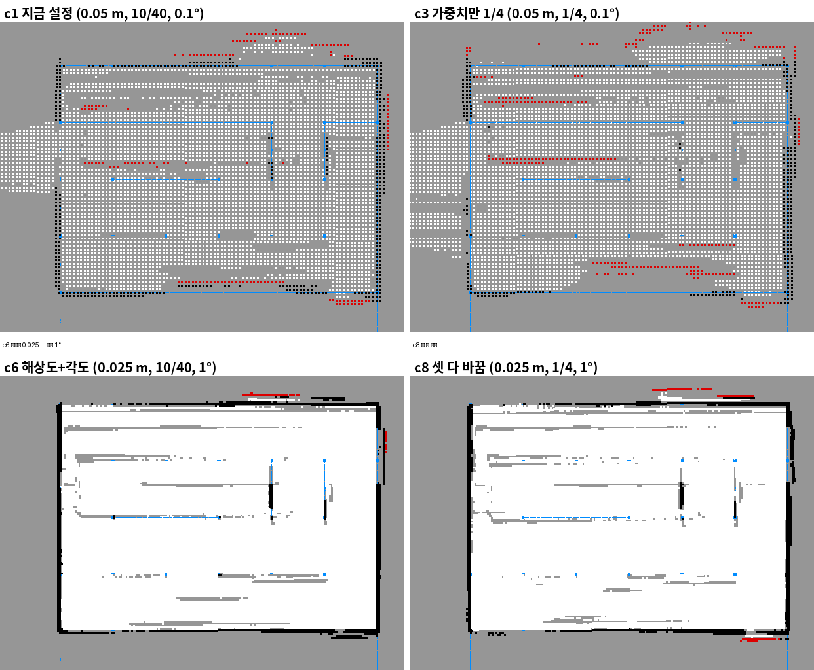
*Cartographer 설정별 지도와 도면 겹침 (모의)*
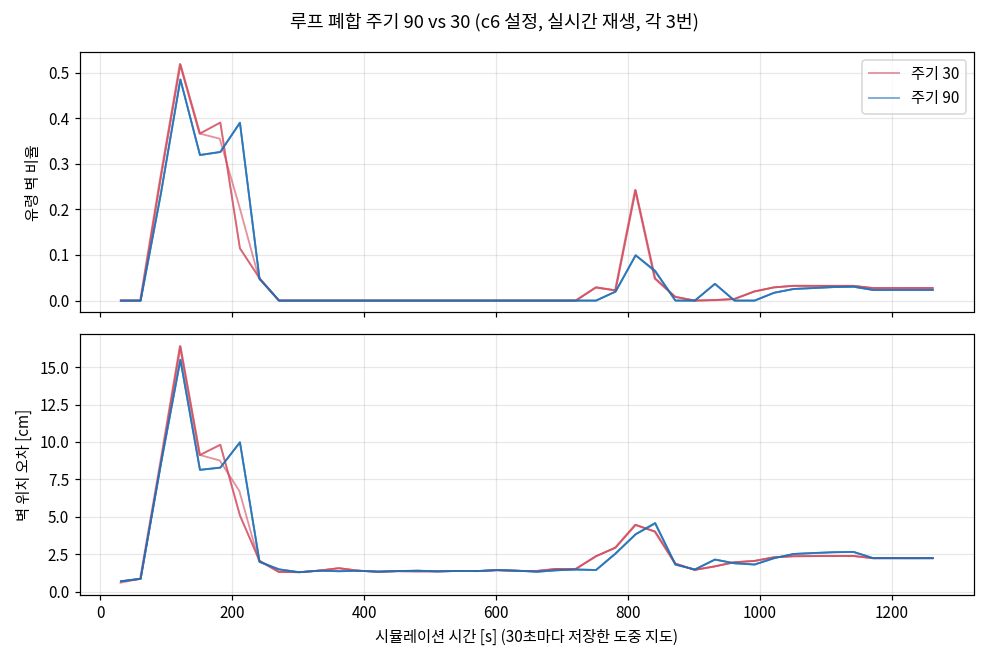
*루프 폐합 주기 90/30 비교 (모의)*

## 3. 로봇 모델과 물리 시험 (10-21 ~ 10-27, 모의)

### 3-1. URDF → USD 판정과 충돌 형상

URDF는 23링크 단일 트리였고 xacro와 수치 차가 없었으며 메시 504개가 모두 있었다. 카메라 광축은 Arducam이 아래로 40.8°, RealSense가 35.3°로 실물과 같았다. MoveIt에서 관절 0 자세와 접은 자세 모두 충돌 쌍이 없었다. 충돌 제외 쌍은 인접한 13쌍만 두었는데, 자동 생성되는 'Never' 49쌍은 실제 충돌을 숨길 수 있어서 넣지 않았다.

USD 판정(②~⑩)은 합성 오류 0, 총 질량 4.8911940 kg, 질량 오차 최대 3.9e-8, 관절 한계 오차 2.9e-6°, 센서 프레임 오차 3.9e-9 m, 충돌 형상 542개로 통과했다. 속도 한계(⑤)와 자기충돌(⑩)은 물리 시험에서 다시 보기로 했다.

충돌 형상 검사에서 261021 판은 C1이 실패했다(arm_link_5 5.5 mm). CAD에서 딸려 온 집게 나사 4세트 때문이었고 실물에는 없는 부품이다. 조각 207개 중 8개를 지운 261022 리비전에서 C1~C3 모두 통과했다.

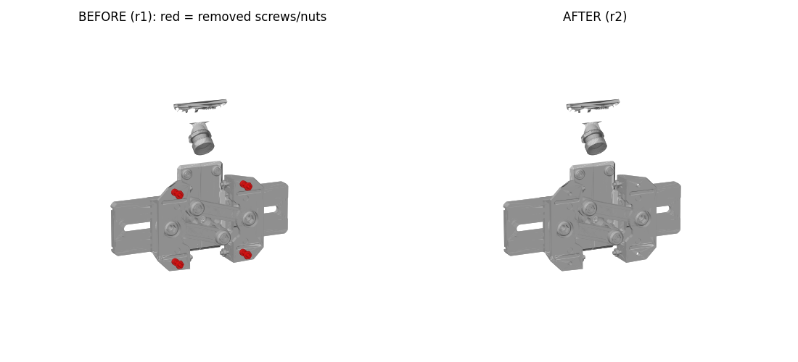
*arm_link_5 나사 제거 전후*
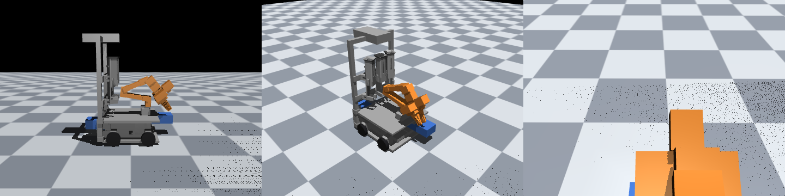
*팔 접은 자세*

### 3-2. 물리 시험 P1~P8

시험 하나를 프로세스 하나로 돌리고 물리 스텝마다 기록해 분석기가 판정하게 했다. 첫 실행(v2)은 P3, P6, P8만 통과했고, v10에서 P1~P8이 모두 통과했다. 기준 조건은 v12로 정했다. 실패는 대부분 측정 방식이나 PhysX 동작 때문이었고 모델 값 자체가 틀린 경우는 없었다.

중력이 있을 때 PhysX 관절 속도 한계가 팔꿈치를 명령과 반대로 움직이는 현상이 있었다(한계만 없애면 정상이었다). 보고 속도가 어긋나는 문제는 TGS 솔버에서만 나왔고, 접촉 침투 5.57 mm는 speculative CCD를 켜서 0.11 mm로 줄였다.

MuJoCo와 비교하니 armature가 0이면 바퀴 속도가 232 rad/s까지 발산했다. XM430-W350 공개 논문 값을 환산해 바퀴 0.0163, 팔 0.045 kg·m²를 넣자 제자리 회전이 Isaac 기준 1.52°에서 42.89°로 바뀌었다.

▶ [MuJoCo M 시험, armature 0과 0.0163 등 비교 (리비전 261022_2119)](../../results/sim_videos/b1_M.mp4)

### 3-3. 속도 제한을 정한 과정

1. 처음에는 인수인계받은 USD 관절 속도 한계(바퀴 2.0, 팔 0.5 rad/s, 임시값)를 PhysX가 그대로 적용하게 두었다.
2. 그런데 위에 적은 대로 중력 아래에서 팔꿈치가 반대로 움직였다. 그래서 PhysX 한계는 끄고 제어기에서 목표 변화율을 제한하는 방식으로 바꿨다(v4). 실물 Dynamixel의 Profile Velocity와 같은 방식이다.
3. 한계값은 ROBOTIS 공식 무부하 속도(11.1 V)로 정했다(v5). 바퀴 XM430-W210은 70 rev/min = 7.3304 rad/s, 팔 XM430-W350은 43 rev/min = 4.5029 rad/s다. Velocity Limit 초기값(75.6, 45.8 rev/min)보다 낮지만 11.1 V에서 실제로 낼 수 있는 값이다. 집게는 환산식이 없어 0.01 m/s를 유지했다.
4. 제어기 한계는 목표에만 걸리기 때문에 실제 팔 속도가 4.9532 rad/s(공식 값의 1.1배)를 넘지 않는지도 판정에 넣었다(v6). 넘치는 부분은 팔 감쇠를 조정해 줄였다.
5. 증속 벨트를 반영한 뒤(261027_1530) 바퀴 한계를 10.995574 rad/s(70 rev/min × 1.5)로 바꿨다.

### 3-4. 기준과 조건을 바꾼 기록

| 판 | 바뀐 것 | 이유 |
|---|---|---|
| v2 | 재질 양쪽 적용, 팔 강성 200, 시간과 판정 표기 정리 | 계획 문서와 불일치 |
| v3 | 속도는 위치 차분, 접촉은 separation ≤ 0, P7 ≥ 1° | 보고 속도와 접촉 보고 문제 |
| v4 | PhysX 속도 한계 끄고 제어기에서 제한 | 팔꿈치 반대 방향 |
| v5 | 공식 무부하 속도, 자기충돌은 팔과 집게의 어느 쌍이든 | 공식 값으로 통일, 판정 쌍 불일치 |
| v6 | 팔 실제 속도 ≤ 4.9532 | 9.35 rad/s까지 넘침 |
| v7 | 리비전 261022_2119, 팔 이득 (200, 12) | 새 리비전 |
| v8 | 팔 이득 (400, 24) | 오차와 속도 모두 나아짐 |
| v9 | speculative CCD | 침투 5.57 → 0.11 mm |
| v10 | 마찰 0.3 / 0.225 | 실측할 수 없어 값을 정해 둠 |
| v11 | armature 바퀴 0.0163, 팔 0.045 | MuJoCo 발산, 회전량 |
| v12 | 팔 이득 (400, 36) | 팔 속도 6.00 → 4.70 |
| v13 | P7을 '회전 ≥ 1°'와 '회전 반경 ≤ 307 mm'로 | 벽에 닿지 않는다는 목적에 맞춤 |

기록 방식도 바꿨다. 보고 속도 대신 위치 차분을, 접촉 보고 대신 separation ≤ 0을 쓰고, 바퀴 각도는 감김을 풀어 기록했다.

### 3-5. 주행 방식 시험 V1~V9와 주행 규칙

팔을 접은 채 제자리 회전(V1)을 하면 회전 반경이 MuJoCo 337.9 mm, Isaac 389.6 mm로 기준 307 mm를 넘어 실패했다. V4·V5 28회, V6 6회, V8 16회, V9(마찰 0.4~0.8) 24회는 성공했다. V6b와 V7은 일부 실패했는데, 멈춘 뒤 헤딩을 보정하게 한 V6c, V6cb, V7c는 46회 모두 성공했다(끝 헤딩 0.46° 이하, 옆 9.0 mm 이하).

그래서 제자리 회전을 줄이고, 모퉁이는 호를 그리며 돌고, 막다른 길에서는 후진하기로 했다. 모퉁이 반경은 0.20 m 이하로 정했다.

▶ [V1~V3 팔 접고 회전 (리비전 261022_2119)](../../results/sim_videos/b2_V1V3.mp4)
▶ [V4·V5 호 회전 (리비전 261022_2119)](../../results/sim_videos/b3_V4V5.mp4)
▶ [V6 (리비전 261022_2119)](../../results/sim_videos/b4_V6.mp4)
▶ [V6c 멈춘 뒤 헤딩 보정 (리비전 261022_2119)](../../results/sim_videos/b5_V6c.mp4)
▶ [V7 (리비전 261022_2119)](../../results/sim_videos/b6_V7.mp4)
▶ [V8 (리비전 261022_2119)](../../results/sim_videos/b7_V8.mp4)
▶ [V9 마찰 0.4~0.8 (리비전 261022_2119)](../../results/sim_videos/b8_V9.mp4)

### 3-6. 리비전 261027_1711 재검사

새 rail(깊이 31.6 → 87.1 mm, 충돌 형상은 CoACD 볼록 분해)을 넣고, 실제로는 없는 무게추 509 g을 뺐고, 출력 부품은 채움률 15%와 껍질 0.8 mm로 가정해 질량을 다시 잡았다. base_link는 4.6156 → 3.0799 kg, 전체는 5.7850 → 4.2207 kg이 됐다.

바퀴 armature는 0.007244(= 0.0163 ÷ 1.5²)와 0.0163을 같은 시험으로 비교해 엔진 간 일치가 더 나은 0.007244를 골랐다(54.5% 대 51.7%).

재검사(MuJoCo 21회, Isaac 약 94회, L2 600초)에서 판정 항목이 모두 통과했다. 최고 속도는 0.363 m/s로 벨트가 없을 때(0.242)의 1.5배였고, 바퀴 토크는 최대 0.13 N·m(상한 1.8)였다. 출발 칸에서 180° 돌 때 벽과의 최소 간격은 Isaac 82.5 mm, MuJoCo 103.7 mm(기준 30 mm)였다.

앞 무게추도 시험했지만 Isaac에서는 0.70, 0.75 kg일 때만 성공해서 쓰지 않기로 했다. 실제 칸 시험은 무게추 없이 통과했다. 정적 계산으로 보면 후방 라이다 스캔 높이가 67.6 mm라서, 차체 뒤 약 290 mm 안에 있는 높이 40 mm 물체는 보이지 않는다.

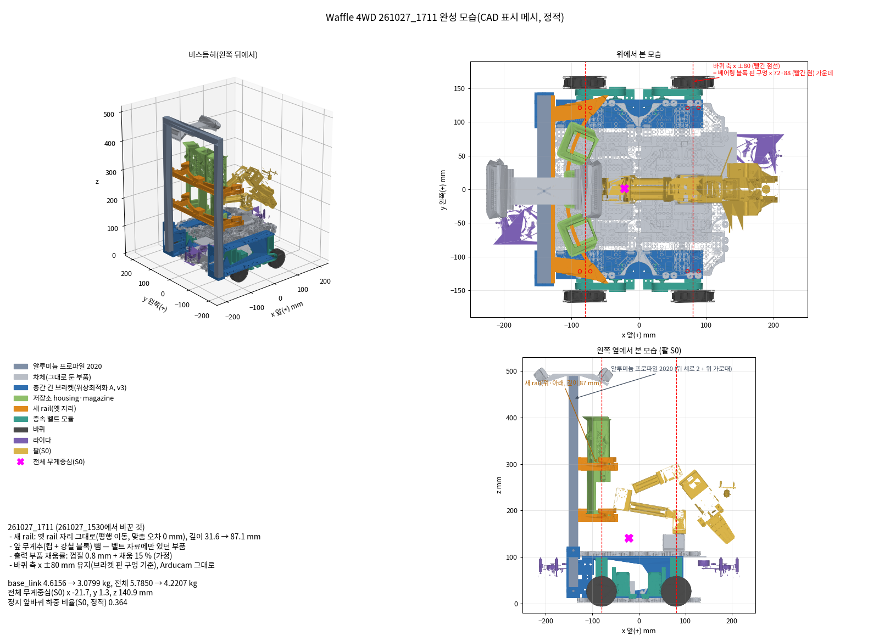
*리비전 261027_1711*
▶ [1711 재검사 M 시험](../../results/sim_videos/a1_M.mp4)
▶ [1711 재검사 V1~V3](../../results/sim_videos/a2_V1V3.mp4)
▶ [1711 재검사 V4·V5](../../results/sim_videos/a3_V4V5.mp4)
▶ [1711 재검사 V6](../../results/sim_videos/a4_V6.mp4)
▶ [1711 재검사 V6c](../../results/sim_videos/a5_V6c.mp4)
▶ [1711 재검사 V7](../../results/sim_videos/a6_V7.mp4)
▶ [1711 재검사 V8](../../results/sim_videos/a7_V8.mp4)
▶ [1711 재검사 V9](../../results/sim_videos/a8_V9.mp4)
▶ [바퀴 armature 0.007244와 0.0163 비교](../../results/sim_videos/c1_armature.mp4)
▶ [앞 무게추 변형별 V1 회전](../../results/sim_videos/c2_ballast_V1.mp4)
▶ [앞 무게추 M5·M6, V1~V4](../../results/sim_videos/c3_ballast_suite.mp4)

## 4. 위치 추정, SLAM, Nav2

### 4-1. Nav2와 위치 추정 모의 (11-02 ~ 11-06)

팀 PR #50으로 회전 중심이 −0.0786에서 −0.0658로 바뀌어 설계 45 B안을 다시 판정했다. 1, 2차는 불통과였다. 계획 경로가 상자를 깎고 지나갔고, 전역 costmap의 두 층 해상도가 달라 받침대가 지워졌기 때문이다. 이를 고친 3차에서 세 판 모두 통과했다(위치 RMSE 0.0072~0.0081 m).

위치를 잃었을 때 다시 보내는 loc_gate와 감지를 개선해 감지 0.17초, 다시 찾은 오차 0.012 m가 나왔고 검사 주기는 0.9 Hz에서 9.9 Hz로 올라갔다.

Cartographer와 AMCL은 같은 조건에서 비교했다. 실행 전에 'RMSE 차이가 0.005 m 이상이면 작은 쪽'이라는 규칙을 정해 두었다.

| | RMSE | 최대 |
|---|---|---|
| 팀 AMCL 설정 | 0.0317 m (기준 불통과) | 0.095 m |
| 최적화한 AMCL (옴니 모델 등) | 0.0154~0.0162 m | 0.028~0.030 m |
| Cartographer | 0.0072~0.0081 m | — |

규칙대로라면 Cartographer였지만 팀 요청으로 AMCL을 쓰기로 했다. Nav2와 AMCL 운용은 주행 담당이 맡고, loc_monitor와 지도는 내가 맡았다. Cartographer는 지우지 않고 launch 인자로 남겼다.

팀 `localization` 패키지(PR #91)는 팀 EKF가 제자리 회전 때 옆 이동을 반영하지 못해 불통과였다. Issue #92가 반영된 뒤 네 판 모두 통과했다(RMSE 0.0156~0.0162 m).

Jetson 부하는 녹화를 재생해서 쟀다(실물 Jetson, 주행 없음). 카메라 3대, YOLO, AMCL, loc_monitor를 30분씩 5판 돌린 결과 CPU 평균 44.0%, GPU 50.2%, YOLO 15 Hz였고 위치 추정 몫은 약 21.5%p였다. 첫 판에서 loc_monitor가 코어 하나를 다 써서 TF를 기다리는 구조를 고쳤다(PR #102, CPU 47 → 33%).

지도에서 주의할 점도 있었다. SLAM 지도는 Isaac 세계(maze.usda)와는 맞지만(중앙값 0.0096 m), maze.usda와 발제 SDF가 동쪽과 북쪽 벽에서 다르다(p95 0.0964 m, 최대 0.1429 m). 세계 모델이 두 개라서 생긴 차이이고, map만 바꾸고 loc_map을 그대로 두면 서로 어긋난다.

정지해 있을 때 LOST로 잘못 나오던 것도 고쳤다(PR #129, LOST:gap 40 → 0).

### 4-2. cuVSLAM과 Cartographer 비교 (실습)

cuVSLAM odom을 Cartographer에 넣는 구성은 실행과 지도 저장까지는 됐지만 위치 정확도가 기준(0.05 m)에 못 미쳤다(모의). 위치 RMSE가 밝을 때 0.203 → 0.293 m, 어두울 때 0.204 → 0.370 m로 오히려 커졌다. 추적이 끊기지 않았다는 것만으로 성공이라고 보지는 않았다.

모의 적외선 영상에는 투사 무늬와 실제 질감이 없어서 cuVSLAM에 불리했을 수 있다. Cartographer는 라이다만으로 모의와 실물 지도를 모두 만들 수 있었고 설정에 따른 효과도 분명했다. cuVSLAM은 이번 모의 조건에서는 정확도가 부족했고, 실물 비교는 하지 못했다.

### 4-3. 실물 미로 지도 (11-14 ~ 11-16)

실물 bag을 PC에서 처리했다. 기준은 계산 전에 '실물 벽의 70% 이상이 SDF 벽 5 cm 안, 반대 방향도 70% 이상'으로 정했다.

11-14 bag으로 만든 c6 지도는 29%, 17%로 벽이 겹쳐 나왔다. 원인을 찾다가 11-15에 실물 상자로 라이다를 가려 보는 시험에서 앞뒤 라이다 TF 요가 약 180° 틀린 것을 발견했다(Issue #303, PR #304). 같은 bag을 TF를 고쳐 다시 돌리니 58%, 43%로 두 배 가까이 좋아졌지만 여전히 기준 미달이었다.

11-16에는 시야를 계산해(99.1%) 경로를 다시 짜고 재녹화했는데, 다섯 판 모두 17~30%, 8~12%로 더 나빠졌다. 바퀴 odom의 회전량이 IMU의 1.32배로 나왔지만 이것이 원인인지는 확인하지 못했다. 결국 시연은 발제 SDF 지도(bringup 기본값)로 하기로 했다(Issue #317).

위치 추정 감시 노드는 C++로 다시 짰다(PR #310). 재생 비교에서 Python 판과 상태 바뀜 19번, lock 4번이 같았다.

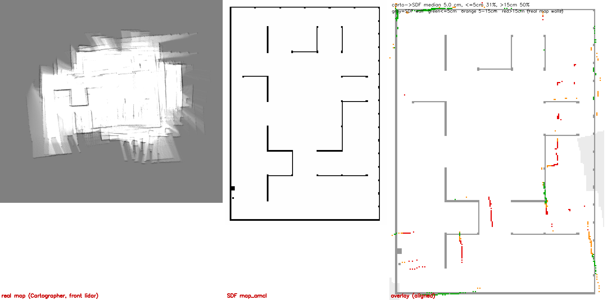
*11-14 bag 지도와 SDF 비교 (실물)*
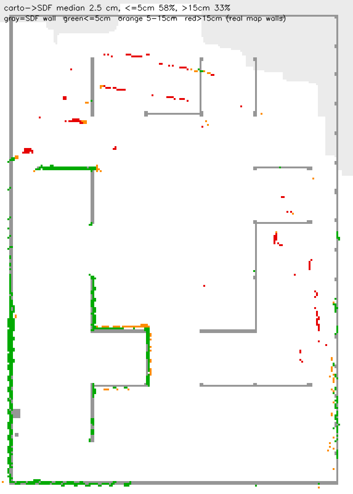
*라이다 TF 요를 고친 뒤 (실물)*
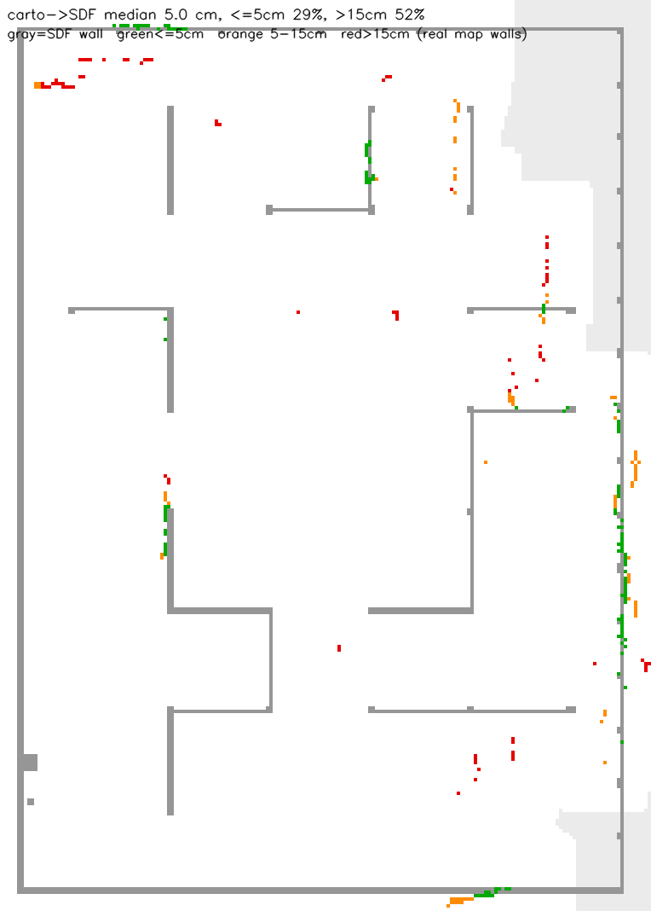
*11-16 재녹화 bag 지도 (실물)*

## 5. 인지 (10-22 ~ 11-13)

10-22부터 10-27까지 인지의 기본 구조를 만들었다. 카메라를 직접 여는 대신 영상 토픽을 받도록 바꾸고, 앞뒤 라이다 합치기와 TFmini 비상 정지를 넣고, 퍽, 태그, 신호등, 주사위, 바코드(C++) 인지와 메시지를 추가했다(PR #2, #3, #5, #7, #8).

### 5-1. 모의 판정

Isaac 렌더를 실제 perception_node에 재생해 판정했다.

| 항목 | 결과 | 처음 실패와 고친 것 |
|---|---|---|
| 신호등 상태(320장), 점멸 순서(100회) | 320/320, 100/100, 틀린 확정 0, 가장 늦은 확정 2.94주기 | 10-28 첫 판정에서 순서 32/40: 자리를 고정하기 전 관측을 버리고 있어 보관하게 함. 3000 K에서 AWB 때문에 빨강 색상이 돌아 63/160, 0/50: 색별 문턱으로 나눔 |
| 바코드(144장) | 144/144, 틀림 0 | 10-28 첫 판정에서 15° 기운 조건 60/72: 회전 후보를 두고 읽음 |
| 퍽 측량(24회, 288칸) | 24/24, 288/288, 중심 최대 5.40 mm | 1차 0/24(틀린 완료는 0): 원기둥 끝면 원형 띠, 누운 직육면체 모양, 잘린 퍽은 '모름' 처리 |
| 팔 정렬 | 팔 YOLO 잠금 204/212, 다른 퍽 0, E3 엔진 206/212 | 색 검출만으로는 다른 퍽을 3번 잡아 YOLO 잠금으로 바꿈 |
| 최종 연결 | 24/24, 288/288, 틀린 완료 0, 중심 최대 4.92 mm (E3) | 후보 C는 23/24: 팔 태그 표를 우선하게 함 |
| TF 기다림 (PR #97) | 촬영 시각 TF 비율이 6위상 모두 1.0 | 끄면 0.044~1.0 |

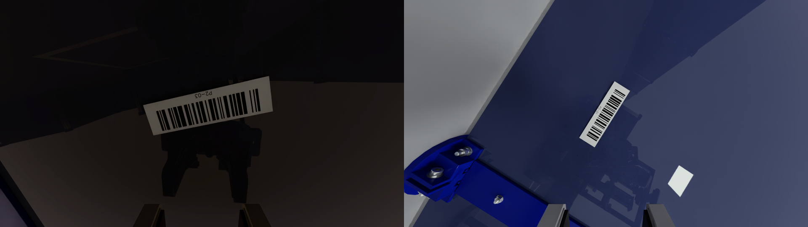
*바코드 판정 (모의)*
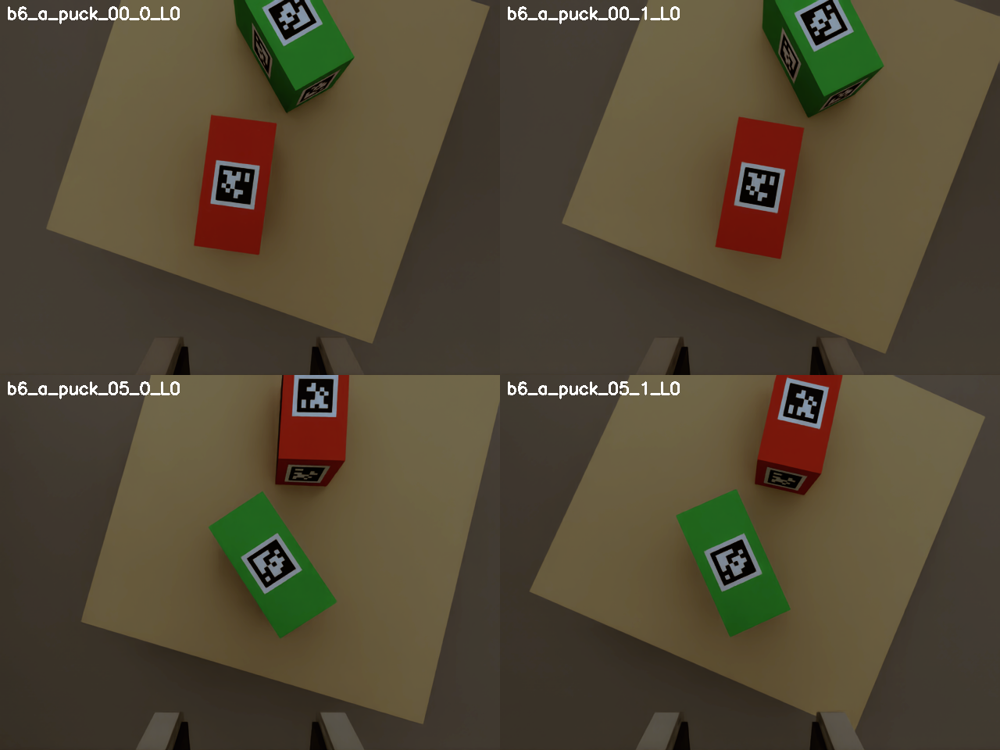
*퍽 측량 판정, 누운 직육면체 (모의)*
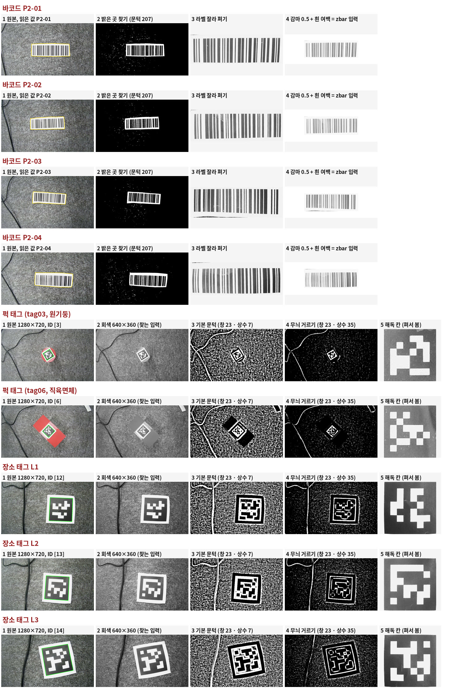
*입력 종류별 2차 판정*

### 5-2. 실물 판독

바코드는 11-04 1차에서 1038장 중 하나도 읽지 못했다. 실물 라벨은 흰 여백이 좁고 둘레가 카펫이라서, 라벨을 먼저 찾아 펴고 읽도록 고쳤다. 11-06 2차에서 4라벨 모두 100%(499장), 틀림 0, Jetson p95 64.8 ms가 나왔다.

태그(퍽 16 mm, 장소 48 mm)는 1차에서 L1 0.347, L3 0.244였다. 1280×720 영상을 640 폭으로 줄여 찾은 뒤 찾은 둘레만 원본 해상도로 다시 찾게 바꿔, 2차에서 15종 모두 1.000, 다른 ID 0, Jetson 중앙값 105.4 ms가 됐다.

11-10 노드 메시지 확인에서는 바코드 4/4, 퍽 12/12, 장소 3/3이었다. Arducam 내부값은 실측으로 fx 865, RMS 0.20 px가 나와 모의에서 가정한 424가 틀렸던 것을 알았다.

### 5-3. 신호등 빨강과 노랑을 높이로도 가른 이유

실물 D435를 노출 80으로 두면 빨간 등이 포화돼(V 254) 색상이 주황 쪽(H 24)으로 밀리고, 노랑(H 30)과 겹친다. 그래서 HSV만 쓰던 코드는 정답 YYYRGRRYRRYR을 YYYYGYYYYYYY로 확정했다. 빨강 6개가 모두 노랑이 된 것이다.

실습실 녹화를 HSV만으로 다시 판별해 보면(녹화 재생으로 근사) 빨강은 1006개 중 0개였고 3판 모두 틀리게 확정됐다. 매번 같은 방식으로 틀리기 때문에 두 묶음 일치 검사로도 걸러지지 않는다.

그래서 켜진 칸의 높이(초록 칸 기준)를 함께 쓰고, 지난 점멸도 다시 읽게 했다(PR #181). 실습실 판정에서 3판 모두 약 25초 만에 한 묶음으로 정답을 확정했고, 틀린 확정은 없었다. 빨강 487/487, 노랑 661/661, 초록 446/446이다.

다만 높이는 카메라 장착과 기울기에 민감하다. 브래킷이 10° 들리면 초록을 놓쳤고, 손으로 들고 찍은 판은 무효로 처리했다.

▶ [신호등 실습실 판정, 높이 사용 (실물)](../../results/sim_videos/p5_judge.mp4)

### 5-4. YOLO 모델 확정

YOLO11n 4클래스 모델이고, 엔진을 B → C → D → E2 → E3로 바꿀 때마다 최종 연결 시험으로 회귀 확인을 했다. D435는 480×640, 팔은 384×640 FP16을 쓴다. 정사각형 640은 위아래 띠 때문에 재현율이 낮았다. Jetson GPU 사용률은 FP32 53.1%에서 FP16 18.9%로 줄었다.

학습과 모델 고르기에 쓰지 않은 새 영상으로 최종 확인을 했다(실물 영상). 앞 D435는 재현율 0.983, 정밀도 0.994, 뒤 D435는 0.996, 0.996으로 통과했고 팔은 0.897, 0.886으로 불통과였다. 11-06에 E3로 확정하면서 팔은 실제 쓰임에 맞게 '색 + 자리' 기준으로 바꿨고, 이 기준으로 0.967, 0.975가 나왔다. 결과를 보고 바꾼 기준이라 바꾸기 전 불통과도 함께 기록했다.

### 5-5. CenterPose 실물 적용 검토

태그 없이 퍽 자세를 추정하려고 CenterPose(상자 crop → 코너 8개 → PnP)를 검토했다. 합성 영상에서는 전체 97.9%, 태그가 안 보이는 퍽 93.3%로 기준을 넘었다(모의).

Arducam을 보정하고(fx 865, RMS 0.20 px) 3D 라벨을 만들어 실제 렌즈로 합성한 영상과 실물 라벨 196개로 더 학습했다. final_arm 영상에서 500 mm 안에 있는 퍽 92개를 채점(중심 10 mm, 긴 축 10° 안)했더니 전체 40.2%(기준 95%), 태그가 안 보이는 퍽 22.7%(기준 85%)로 기준에 못 미쳤다(실물 영상). PC 지연 p95 29.6 ms는 기준(33.3 ms) 안이었다.

태그가 없는 퍽에도 값을 내긴 하지만 중심 오차 p95가 약 92 mm라서 잘못된 자세로 팔을 움직일 위험이 있다. 그래서 이번 시스템에는 넣지 않고 태그 기반 자세를 그대로 썼다. 이 결과는 '이번 자료 양과 시간 안에서는 기준 미달'이라는 뜻까지만이다. 실물 학습 자료가 적었고, 태그 없는 퍽의 정답은 사람이 맞춘 값이다. 태그 방식의 실물 정확도는 독립된 정답이 없어 비교하지 못했다.

## 6. 실물 주행과 인지 실물 측정 (11-07 ~ 11-16)

- Jetson 배포: dev 빌드 11개 패키지가 7분 8초에 끝났고, 엔진 해시가 일치했으며 오류는 없었다.
- 실물 TF와 팔 카메라: 실물 TF를 기준 모델 B안에 맞췄다(PR #56). IMU 보드가 90° 돌아 달려 있어 yaw −90°를 넣었다(PR #162). 팔 Arducam은 OpenCV 노드로 1280×720을 받게 바꾸고(PR #140) 실측 보정 파일을 넣었으며(#146), 거꾸로 달려 있어 영상을 180° 돌려 발행했다(#147, #153).
- 팔 카메라 입력은 처음에 15.3 Hz였다. 전송 손실(best effort)과 캡처 버퍼 1장이 원인이었고, 공유 메모리를 키우고 버퍼를 2장으로 늘려 30.6 Hz, stamp 나이 p99 13 ms가 됐다(PR #148, #150).
- 인지 노드 부하: 태그 읽기가 느린 원인은 통신이 아니라 계산(축소 영상 검색 48.4 ms 등)이었다. 검색을 줄인 뒤에도 잃는 것은 없었다(551/564 그대로).
- 11-13 정지 상태에서 전체 구성의 CPU가 평균 95.9%였고 인지 결과가 늦어졌다. 담당마다 줄일 곳을 Issue #265로 요청했고, 내 쪽은 위치 추정 노드 C++ 판과 조사 노드의 TF 리스너 줄이기로 대응했다(PR #310).
- Jetson에서 컨트롤러 spawner가 첫 bringup 9번 중 6번 실패했다(Issue #275). 11-15 재측정에서는 8판 모두 4/4였고 `/joy`는 20 Hz였다.
- 팔 카메라 렌즈가 설계 계산보다 약 20 mm 낮았고 자세마다 달랐다(Issue #278). 자세별 실측 보정을 넣어 두었다(PR #296, 기본은 꺼 두고 실물 확인 뒤 켬).
- 바퀴 주행 시험은 바퀴 브래킷 문제로 판정하지 않았다.

## 7. 강화학습 (모의)

### 7-1. RL1 팔 목표 위치 도달 (10-25 ~ 10-27)

Isaac Lab ManagerBasedRLEnv에서 PPO로 팔 4관절 위치 목표를 30 Hz로 학습했다. 기준은 처음부터 끝까지 바꾸지 않았다: 3초 안에 오차 10 mm 이하 95% 이상, 도달 시간 중앙값 1.5초 이하, 팔과 차체 접촉 0, 속도와 토크, 유지 중 떨림.

v1부터 v15까지 모두 전체 기준을 통과하지 못했다. 가장 나은 v8이 도달 92.9%, 1.03초, 접촉 37구간이었다. 떨림은 정책 출력이 15 Hz로 부호를 뒤집는 것이 원인이었다. v15에서 멈췄다.

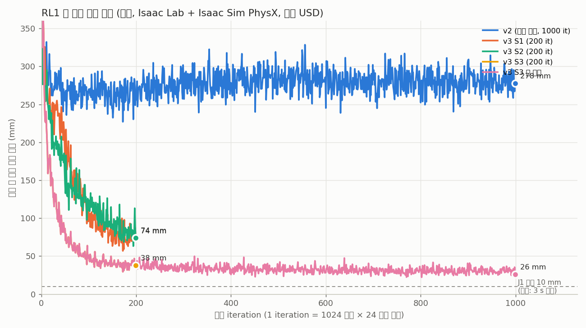
*RL1 학습 곡선 v2·v3*
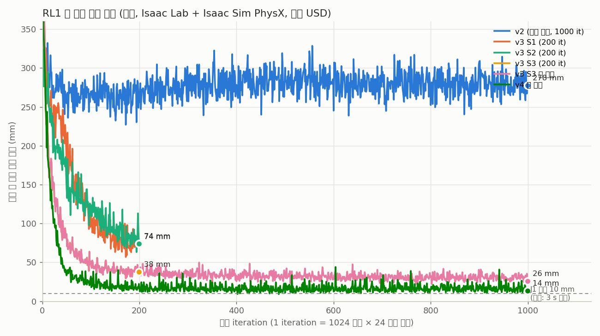
*RL1 학습 곡선 v4*

### 7-2. #192 누운 직육면체 세우기 (11-10 ~ 11-11)

정해진 동작 순서(각본)로는 성공률이 73.0%였다. 그래서 새 환경 `Waffle-LieUpright`(PPO, 2048개 환경, 행동 6)를 만들어 학습했다.

r2c에서 시작해 r2d(팔과 상자 사이 힘이 1 N을 넘으면 종료), r2e(옆 퍽에 닿으면 벌점)로 바꾸며 접촉 없는 성공이 96.4%가 됐다. 이어서 노드 조건에 맞췄다. 관절 속도를 비례로 줄이는 상한 3.0 rad/s에서 95.4%가 나와 이를 노드 기본값으로 했다. 노드 순서대로 돌린 판정은 92.2%로 불통과였는데, 관측과 놓는 규칙이 학습 때와 달랐기 때문이다. 관측을 노드와 같게 바꿔 다시 학습했다.

최종으로 r2g2를 채택했다. 3.0 rad/s에서 95.7%, 노드 판정 98.9%, 미션 순서대로 칸에 넣기까지 81.8%다. C++ 노드와 ONNX 출력을 학습 기록과 비교해 관절 목표 최대 차이가 6.7e-4 rad인 것을 확인하고 배포했다(PR #217).

결과를 본 뒤 기준을 바꾼 것이 세 번 있다. 상태를 옮길 때의 관절 기준을 0.01에서 0.02 rad로 바꿨고(중력 처짐이 섞여 있었다), 잡는 점 이동 5 mm는 판정에서 관찰 항목으로 돌렸고, r2g2의 4.0 rad/s 결과(90.3%)는 노드 상한이 3.0이라 판정이 아닌 기록 항목으로 돌렸다. 세 경우 모두 바꾸기 전 불통과를 함께 기록했다.

실물에서는 11-12 팔 담당 시험(#192)을 옛 정책 r2e로 해서 실패했다. 직접 보고 보정값이 없었던 탓으로 판단해 재학습은 하지 않았다. r2g2는 실물에서 아직 확인하지 못했다.

## 8. 미션 (11-10 ~ 11-13)

### 8-1. 재검증 기록과 보기 자세 (모의)

verify 단계에서 장소별 퍽 ID를 기록하고 중복이나 누락을 판정하게 했고, 미션마다 기록 폴더를 남기게 했다(PR #174, #175, #176, #186).

FINE 정렬 자세 ALIGN은 차체에 닿거나(15.5 N) 실어 둔 퍽과 겹쳐서(−11.4 mm) 모든 기준을 만족하는 자세가 없었다. 결과 표를 담당에게 넘겼다(#218, #219).

target_look 오차를 나눠 보니 영상 잡음은 축마다 0.80 mm로 작았고, 주된 원인은 장착과 FK 보정이었다. 카메라 높이가 ±3 cm 틀리면 place_box 결과가 17~110 mm 틀린다. 실물 보정이 필요한 이유다.

### 8-2. 상자가 ±5 cm, ±45°로 놓일 때 (모의)

앞 D435로 상자를 재는 시험 240장에서 15 mm, 4° 안에 240장이 모두 들어왔다(최대 2.10 mm, 2.09°). measure_front 서비스로 넣었다(PR #228).

상자 면에 수직으로 다가가면 퍽이 상자 변을 가려 실패했다. 그래서 비스듬히 서서 보게 했다. place_box는 0.44 m, 50°에서 224/224, 태그는 같은 자리에서 0.40 m, 55°로 다시 봐 98.9%였다. 미션 흐름은 Issue #229와 PR #247로 반영했다(기본은 꺼 둠, #229 변경은 #247과 함께 병합).

place_box도 고쳤다. 화면 밖 후보를 빼고(PR #223), 카메라 높이 오차에 덜 민감하게 바꿨다(PR #234: ±1 cm에서 60~95 mm 틀리던 것이 0.66 mm 안으로). 놓을 칸은 상자 축을 따르게 했다. 주사위 무늬가 상자와 함께 돈 것이 정답이라고 봤기 때문이다.

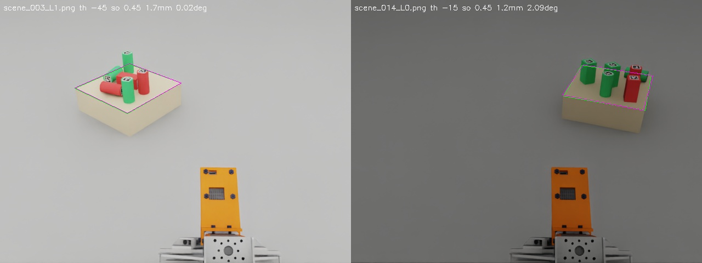
*앞 D435 상자 측정 판정 (모의)*
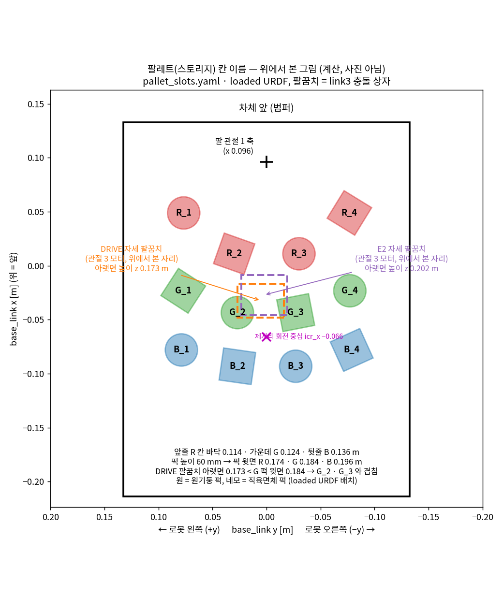
*스토리지 칸 이름*

### 8-3. #226 시작 상자가 돌아 놓였을 때 집는 방향 (모의)

계산해 보니 제자리 회전은 J1 위치만 옮길 뿐이라, 제안된 '기본각 + β'는 방향이 반대였다. 왼쪽 퍽에서 β = +10°일 때 이 방식은 14.7° 어긋나고 아무것도 안 하면 10.1° 어긋난다. 회전을 ±30° 해도 J1에서 퍽을 보는 방향은 약 ±14°만 바뀐다.

그래서 대기 자리에서 상자를 재고, 남는 면 어긋남이 가장 작은 회전각(실제 회전 중심 기준)으로 돌린 뒤, 잰 상자로 계산한 퍽 자리로 집게 했다(PR #247, 병합). 모의 9가지 경우 모두 끝까지 갔고 퍽 자리 오차는 0.07 mm 안이었다.

그래도 어긋남은 남는다. β ±30°의 불리한 쪽에서 23.7°, ±45°에서 24.2°, 27.7°다. 정책 성공률은 20°를 넘으면 떨어지기 때문에(모의: 20~30°에서 77.9%, 30~45°에서 63.2%) 면에 수직으로 다시 서는 방법을 모의해 봤다. 20°를 넘는 476가지 경우 중 13%(64가지)만 가능했다. 통로 벽에 막힌 경우가 160가지, ±45°에서 방향 부호가 모호한 경우가 252가지였다. 그래서 다시 서기는 보류하고, 차선으로 손목(J5)을 돌려 면을 맞추는 방법을 팔 담당에게 요청했다(Issue #251).

## 9. 실물 카메라 보정, 상자 측정, 처리 시간 (11-12 ~ 11-13)

| 항목 | 방법 | 결과 | 결론 |
|---|---|---|---|
| 앞 D435 피치 | 책상 위 상자에 노트북을 180° 펼쳐 화면에 태그 판을 띄우고 PnP, 깊이로 책상 면 평면 | 판 −2.55°, −2.65°, −2.56°. 고친 값으로 새로 놓으면 +0.09°, 깊이 −2.42° → 고친 뒤 +0.16° | URDF 35.20° → 32.62° (PR #240) |
| 앞 D435 요 | 판을 고정하고 자동 직진, 장마다 머리 방향에서 움직인 방향을 뺌 | 앞뒤 짝 평균 −0.60° (폭 0.19) | 통과 (한계 0.7°) |
| 직진 쏠림 | 위 측정에서 함께 얻음 | 앞뒤 모두 오른쪽 옆 미끄럼 2.35° (1 m에 4.1 cm, 눈으로 4.5 cm) | 바닥 경사인지부터 가르는 시험을 바퀴 담당에게 (Issue #248) |
| 뒤 D435 | 같은 주행, 깊이로 바닥 평면 | 요 −0.67° 통과, 피치 +1.25° 불통과 | 0.5926으로 고침 (PR #253). 확인 촬영 두 번에서 남은 피치 +0.19°, +0.18°로 통과 |
| 실물 상자 재기 | 과제 상자 4가지 배치와 빈 바닥 | 빈 바닥에서 잘못 찾은 것 0. 상자는 배율 1.0으로 0/10, 배율을 풀면 10/10, 중심 15~29 mm | 불통과. 낡은 상자 윗면과 정답 기준이 의심되나 원인 미확정 |
| Jetson 처리 시간 | 렌더 80장, 카메라 3대와 인지 노드를 함께 돌림 | 앞 장당 1.32초 통과, 팔 p95 4.77초 불통과 | 팔 배율 후보 5개 → 3개 (PR #250, 계산상 약 2.9초, 실물 재측정 남음) |

라이다 위치는 실물 xacro와 Isaac 모델(브래킷 v2)이 앞뒤 바깥쪽으로 22.9 mm, 아래로 8.0 mm 달라 Issue #249로 알렸다.

## 10. 팀 코드 재사용

이전 모듈 팀 코드(Lv2_Monglian_Assignment)는 가져오지 않았고 새 팀 저장소에서 처음부터 작성했다. 운영 측 예제(waffle-lyrical-slam)에서는 허락을 받고 Waffle Pi SDF와 미로 자료만 썼으며, 코드는 가져오지 않았다.

## 11. 한계와 남은 일

결과의 대부분은 모의다. 실물로 확인한 것은 카메라 장착 각, 인지 판독(바코드, 태그, 신호등), Jetson 부하, 실물 미로 지도(기준 미달)다.

남은 실물 일은 상자 측정이 틀린 원인(정답 기준, 성한 상자로 다시), #226 실물 확인(재기 → 회전 → 집기), 팔 카메라 높이(#278, #296 자세별 보정 실물 확인), 팔 처리 시간 재측정, 실물 미로 지도가 나빠진 원인이다.

모의에서 정한 문턱(태그, 엔진, 신호등 하한, 잔차 0.034 등)은 실물에 맞춘 값이 아니다. 물성, 마찰, armature도 실측값이 아니다.

## 부록. PR과 Issue

- 내가 낸 PR(모두 병합)
  - 인지: #2, #3, #5, #7, #8, #18, #19, #21~#29, #32, #33, #42, #44~#48, #51, #54, #57, #58, #68, #72, #80, #90, #95, #96, #97, #100, #103, #120, #123, #124, #125, #126, #130, #131, #137, #147, #150, #158, #159, #171, #180, #181, #210
  - 장치, bringup: #9, #16, #56, #140, #146, #148, #153, #162, #164, #182
  - 위치 추정: #91, #102, #122, #129, #310
  - 미션, 강화학습: #174, #175, #176, #186, #198, #203, #212, #215, #217, #223, #228, #232, #234, #240, #247
  - 실물 보정, 장치: #250, #252(udev), #253(뒤 D435 피치), #256(scan_body_mask), #280(TFmini 중복), #296(팔 카메라 자세별 보정), #309(udev 라이다 이름)
  - 라이다: #304
- 올린 Issue(일부): #92, #93, #121, #133, #187, #192, #201, #216, #218, #219, #221, #225, #226, #229, #248, #249, #251, #303, #317
- Isaac 물리 시험(P1~P8)은 영상 파일이 없고 `261022_2119/phys_tests/run_all.sh`로 화면에서 다시 볼 수 있다. YOLO 학습과 판정에 쓴 실물 녹화(7묶음, 약 16 GB)는 자료라서 보고서에는 넣지 않았다.
