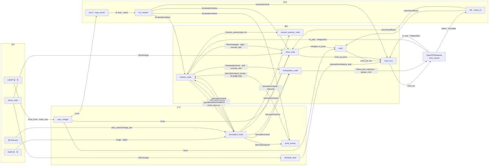
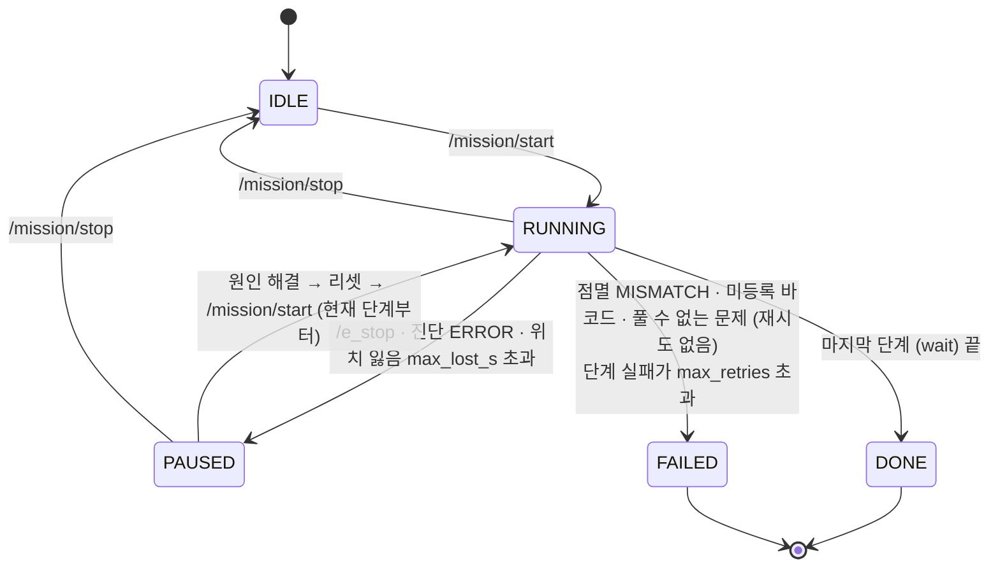
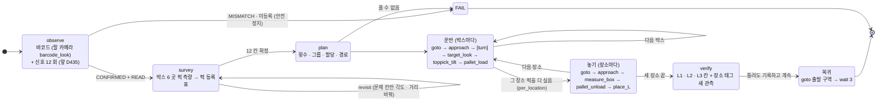
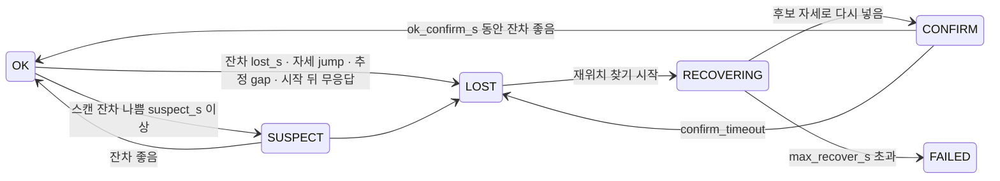

# 노드 · 토픽 · 상태도 (중간 제출)

기준: Integration 브랜치 2026-11-09. 토픽 · 액션의 전체 표 (타입 · QoS) 는 [`workspace/docs/interfaces.md`](../../workspace/docs/interfaces.md), 프레임은 [`frames_tf.md`](../../workspace/docs/frames_tf.md), 노드 설계는 [`robot_nodes.html`](../../workspace/docs/robot_nodes.html).
이 문서는 주사위 기억 로봇 미션 (plan 모드) 에 쓰는 것만 추렸다.

## 1. 노드 구성

| 컨테이너 · 프로세스 | 노드 | 패키지 | 하는 일 |
|---|---|---|---|
| ① ros2_control_node | OpenCRHardware, diff_drive_controller, arm_controller, gripper_controller, joint_state_broadcaster | opencr_hardware | OpenCR 2 대 (주행 ID 1~4 · 팔 ID 11~16) USB, 잠금식 E-stop, /diagnostics |
| 센서 드라이버 | coin_d4_driver ×2, realsense2_camera ×2, arm_camera_node, tfmini_node | bringup `sensors.launch.py`, perception | LiDAR 앞뒤, D435 앞뒤, 팔 Arducam 1280×720, 1층 TFmini |
| ⑦ perception_container | perception_node, scan_merger, rear_obstacle | perception | 신호등 · 바코드 · 퍽 · 장소 태그 · 주사위 칸 · 장소 상자 인식, 스캔 합치기, 뒤 장애물 |
| ⑦ 옆 | puck_survey | perception_survey | 시작 박스 6 개 · 퍽 12 칸 측량 → 퍽 등록표 |
| ⑧ | obstacle_stop | perception | TFmini 박스 거리로 비상 정지 잠금 |
| localization | amcl, map_server, loc_monitor | localization | 문서 좌표 지도 (`map_amcl`) 위 위치 추정, 위치 잃음 판정 · 잠금 |
| nav2 | planner · controller · bt_navigator · collision_monitor … | navigation | 주행 (`map_nav`, 박스 70 mm 포함) |
| ⑧ control_container | drive_node, manipulator_node, mission_node | control, mission | 정렬 · 회전 skill / IK · 집기 · 놓기 skill / 미션 순서 |
| 단독 | mission_planner_node | mission_planner | 신호 · 바코드 · 퍽 → 할당 · 적재 · 경로 계획 |
| 기타 | twist_mux, ekf, odom_icr, robot_state_publisher, joy · teleop | bringup | 속도 명령 우선순위 · 잠금, 오도메트리 융합 |

## 2. 노드 · 토픽 그래프 (미션 경로)

명령 주체는 하나: 바퀴 = drive_node (nav2 도 drive 를 거쳐), 팔 · 그리퍼 = manipulator_node. mission_node 는 순서만 정하고 직접 움직이지 않는다.

## 3. 미션 상태도

### 3-1. 실행 상태 (`/mission/status`)

### 3-2. 미션 단계 (plan 모드, 발제 05 쪽 ① ~ ⑧)

단계 실패 처리: 실패 · 타임아웃이면 진행 중 goal 을 모두 취소하고 그 단계를 `max_retries` 번 다시 한다. `toppick_tilt` 실패는 바로 앞 `target_look` 부터 (#69).

### 3-3. 위치 상태 (`/localization/status`, loc_monitor)

OK · SUSPECT 가 아니면 `/localization/lock` 으로 Nav2 속도만 막고, mission 은 Nav2 단계를 기다린다 (시간에 세지 않음). Gazebo 에서는 회전 중 거짓 LOST 가 있어 기본으로 끔 (#151).

## 4. 기록 (채점 근거)

| 파일 | 만드는 곳 | 내용 |
|---|---|---|
| `signal.json` · `allocation.json` · `plan.json` · `mission_lines.txt` | 계획기 `log_dir` = `<log_dir>/planner`, plan 성공 뒤 에피소드 폴더 `planner/` 로 사본 | 관측한 색 12 개 · 횟수 · 바코드, 그룹 · 할당, 계획 단계 |
| `mission_log.jsonl` | 미션마다 `<log_dir>/<YYMMDD_HHMM>/` (bringup 기본 `~/Lv2_Cartlidar_Assignment/mission_log`) | observe · survey · plan · verify (칸 판정 · 칸별 퍽 ID · 위치) · verify_ids (ID 중복 · 누락) · snapshot · copy · finish |
| `pucks_survey.yaml` | `<log_dir>/pucks_survey.yaml` (mission_node survey_finish), survey 성공 뒤 에피소드 폴더에 사본 | 실제 측량한 퍽 등록표 → 계획기 입력 |
| 이동 전후 이미지 | 에피소드 폴더 `images/`, 팔 카메라 사건당 3 장 (`/perception/snapshot`, perception 이 READ_TAG · ARM_ALIGN 모드일 때) | 이동 전 `NN_before_r<회차>_B<박스>_<k>.jpg` (survey_view), 이동 후 `NN_after_<L>_<k>.jpg` (verify). 전체 영상은 따로 |
